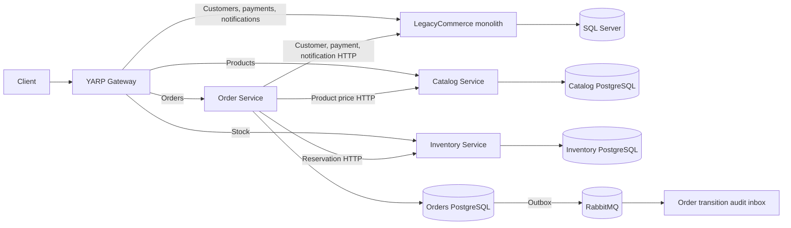

# StranglerForge

StranglerForge is an **educational enterprise architecture reference implementation** of incremental LegacyCommerce modernization on .NET 10. It demonstrates a Strangler Fig migration from a SQL Server modular monolith through a YARP gateway to extracted Catalog, Inventory, and Orders services backed by PostgreSQL. It is not a production-ready commerce platform.

## Repository guidance

See [Contributing](CONTRIBUTING.md), [Security](SECURITY.md), and the [Changelog](CHANGELOG.md). The GitHub Actions workflow restores and builds the solution, then runs gateway tests. The full database-backed suite requires isolated SQL Server and PostgreSQL instances and is validated locally; live RabbitMQ and Docker Compose checks remain separate operational gates. No release version or license has been assigned.
## Architecture and ownership



Catalog owns products and prices. Inventory PostgreSQL now owns stock, reservations, adjustments, and Inventory audit; the monolith retains customers, payments, and customer notifications. Orders PostgreSQL owns orders and saga state. The monolith never queries another service database. See [current architecture](docs/architecture/current-architecture.md), [impact analysis](docs/architecture/inventory-extraction-impact.md), and [cutover procedure](docs/migration/inventory-cutover.md).

## Prerequisites

Install .NET SDK 10, SQL Server, and PostgreSQL. RabbitMQ is required for RabbitMQ runtime validation and production messaging. Docker Compose is optional for container deployment. Supply database and broker credentials through environment variables or an ignored `.env` file; do not commit secrets. The Inventory and Orders APIs have no checked-in database passwords or internal token.

The Phase 04 Catalog service requires `ConnectionStrings__Catalog` and `Catalog__WritesEnabled=true` after its cutover. The monolith defaults to `CatalogOwnership__Mode=Extracted`, with `CatalogService__BaseUrl=http://127.0.0.1:5082/`. Development defaults are now post-cutover: `InventoryOwnership__Mode=Extracted` and all six gateway Inventory routes target the `inventory` cluster. For another deployment, verify its import before setting `InventoryOwnership__Mode=Extracted`, `InventoryService__BaseUrl=http://127.0.0.1:5083/`, and all six `ReverseProxy__Routes__<route>__ClusterId=inventory` values (`inventory`, `inventoryStock`, `reservationCreate`, `reservationById`, `reservationRelease`, `reservationConfirm`). Switch these as one deployment step under a write freeze.

## Restore, build, and test

From the repository root:

```powershell
dotnet tool restore
dotnet restore StranglerForge.slnx
dotnet build StranglerForge.slnx --no-restore
dotnet test StranglerForge.slnx --no-restore
```

Tests need local SQL Server and isolated PostgreSQL databases. Set `CATALOG_TEST_CONNECTION`, `INVENTORY_TEST_CONNECTION`, and `INVENTORY_BROKER_TEST_CONNECTION` to separate test databases. The legacy test factory targets the dedicated SQL database `StranglerForgeLegacyCommerceTests`; the Catalog import test targets `StranglerForgeCatalogMigrationTests`. Apply the Inventory migration to each PostgreSQL test database before the first run:

```powershell
$env:ConnectionStrings__Inventory = $env:INVENTORY_TEST_CONNECTION
dotnet tool run dotnet-ef database update --project src/Services/Inventory/Inventory.Infrastructure --startup-project src/Services/Inventory/Inventory.Api
```

Run the same migration command with `ConnectionStrings__Inventory` set to each other Inventory test or development database. The Inventory service itself does not auto-migrate on startup. The concurrency and outbox tests use real PostgreSQL; the normal event tests use MassTransit's in-memory transport. The broker-outage test uses unreachable RabbitMQ and asserts that committed stock and outbox rows persist. It does not establish recovery on a real broker.

## Run services locally

After setting `ConnectionStrings__Catalog`, `ConnectionStrings__Inventory`, and `ConnectionStrings__LegacyCommerce`, and starting RabbitMQ, run four terminals:

```powershell
dotnet run --project src/Services/Catalog/Catalog.Api --urls http://127.0.0.1:5082
dotnet run --project src/Services/Inventory/Inventory.Api --urls http://127.0.0.1:5083
dotnet run --project src/LegacyMonolith/LegacyCommerce.Api --urls http://127.0.0.1:5081
dotnet run --project src/Gateway/StranglerForge.Gateway --urls http://127.0.0.1:5080
```

Configure `RabbitMq__Host`, `RabbitMq__Username`, and `RabbitMq__Password` for the Inventory service. `RabbitMq__UseInMemory=true` is for isolated local validation only. The `scripts/validate-inventory-local.ps1` script starts all four services against supplied isolated databases, selects extracted Inventory mode, checks health, processes successful and failed payments, verifies insufficient stock, and checks Inventory outage handling. It uses in-memory messaging and does not perform a production cutover.

Inventory validates product existence through Catalog HTTP before accepting stock additions; unknown products return 404. The public Inventory contracts are `GET /api/inventory/{productId}` and `POST /api/inventory/{productId}/stock` with the existing JSON `quantity` field. New reservation APIs are `POST /api/inventory/reservations`, `GET /api/inventory/reservations/{id}`, and `POST /api/inventory/reservations/{id}/release|confirm`. Reservation IDs are stable and equal to order IDs in the monolith. Clients that may retry `POST /api/orders` should supply a GUID `Idempotency-Key` header; the same key returns the same order without another reservation. Existing requests without the header remain valid. The service health endpoint is `/health`. Set `Inventory__DiagnosticsEnabled=true` only on trusted internal deployments to expose `/internal/inventory/outbox` pending counts.

## Data migration and cutover

After review of missing Catalog product references, `Catalog.Migration --append-missing` can copy only missing, stock/order-referenced SQL product GUIDs under `CATALOG_WRITE_FREEZE_ACK=true`. It leaves existing Catalog rows untouched and passed an isolated append/repeat test. It was run on the development database under a write freeze: 21 missing referenced GUIDs were added, 25 existing Catalog rows were preserved, and a repeat added zero rows. The Inventory one-shot tool reads legacy SQL stock and pending orders, verifies Catalog product IDs, writes Inventory PostgreSQL only under `INVENTORY_WRITE_FREEZE_ACK=true`, and checks totals, IDs, pending reservations, and source stability. It refuses divergent target data. Under a real write freeze:

```powershell
$env:INVENTORY_WRITE_FREEZE_ACK = 'true'
dotnet run --project src/Services/Inventory/Inventory.Migration -- --import
dotnet run --project src/Services/Inventory/Inventory.Migration -- --verify
```

All three connection strings must be set. A second import before cutover confirms idempotence. Never re-import after Inventory accepts writes. The isolated migration run copied one seed stock row (25 available), preserved its product GUID, and passed verification and a second import. A separate pending-order run preserved one reservation ID and 23 available units from 25 physical units. The development migration verified 43 stock rows, zero pending reservations, 46 Catalog products, and 67 available units before traffic resumed. The through-YARP validation then exercised new Inventory writes and order processing; do not rerun the import against this target. See [cutover and rollback](docs/migration/inventory-cutover.md).

## Docker Compose

`deploy/docker/compose.yml` defines SQL Server, separate Catalog, Inventory, and Orders PostgreSQL instances, RabbitMQ Management, all three extracted services, monolith, gateway, and bootstrap/cutover tools. Set `SQLSERVER_SA_PASSWORD`, `POSTGRES_PASSWORD`, `INVENTORY_POSTGRES_PASSWORD`, `ORDERS_POSTGRES_PASSWORD`, `ORDERS_INTERNAL_TOKEN`, `RABBITMQ_USER`, and `RABBITMQ_PASSWORD`. For a fresh deployment, resolve source references and freeze writes, then start the databases and broker, run the Catalog/Inventory/Orders import and verify jobs in sequence under their respective freezes, then start the application stack. The Compose application configuration is post-cutover and must not be launched as the authoritative deployment before import succeeds.

Phase 05.1 inspection found no Docker Desktop installation, Docker CLI or Engine, native RabbitMQ/Erlang service, or RabbitMQ executable in Ubuntu WSL. Ports 5672 and 15672 were closed. The Phase 05.1 Compose YAML parsed locally with 13 services; Phase 06 extended it to 17 services, and the Inventory service RabbitMQ host and health dependency were checked; `docker compose config`, container startup, and service connectivity could not run.

## Validation snapshot

The final local restore and build passed with zero warnings and errors. The Phase 06 solution run passed 51 tests: 19 gateway, 13 legacy/Catalog, 7 Inventory, and 12 Orders. Build had zero warnings and errors. The earlier Phase 05 through-YARP workflow passed paid and failed payments, idempotent retry, insufficient stock (409), Inventory outage (503), and compensation retry. The Phase 06 through-YARP workflow passed confirmed, payment-rejected, and insufficient-inventory Orders with `201` submission and `202` payment intent. Compose YAML parsed with 17 services. Phase 05.1 repeated restore, build, and all 38 tests against isolated databases. The Phase 05 tests establish transactional stock/outbox persistence during broker outage and duplicate audit/inbox behavior on the in-memory transport. They do not establish live RabbitMQ publishing, consumer processing, outbox replay after reconnection, duplicate delivery through RabbitMQ, retry/error queues, consumer restart recovery, or end-to-end HTTP-to-event correlation. Those checks were not executed because neither broker nor Docker runtime was available.

## Known limits

Orders PostgreSQL, Inventory PostgreSQL, and monolith Payment/Notification SQL transactions remain separate. The persisted saga retries stable remote commands and compensates definitive payment rejection; prolonged uncertain payment outcomes require operator review. RabbitMQ delivery is designed for at least once processing; outbox/inbox and EventId deduplication are configured, but live broker behavior remains unverified. Inventory stock adjustments through the public API should be restricted to trusted callers during deployment; authentication is outside the current reference phase.


## Phase 06 Orders

Orders owns `Orders`, `OrderItems`, persisted `OrderSagas`, transition audit, inbox, and outbox in its own PostgreSQL database. YARP routes `POST /api/orders` and `GET /api/orders/{id}` to Orders. The public payment route remains on LegacyCommerce and forwards payment intents through a token-protected internal HTTP boundary. The monolith refuses direct order create/read requests in extracted mode, preventing a second order writer. The Orders host uses the real RabbitMQ transport by default; `RabbitMq__UseInMemory=true` is only for isolated local tests.

`POST /api/orders` returns `201` with an initial `Submitted` order. Inventory and payment processing are asynchronous. Clients should supply a GUID `Idempotency-Key` and poll `GET /api/orders/{id}`. Payment submission returns `202` for extracted orders. Terminal new statuses include `Confirmed`, `Cancelled`, and `Failed`. Historical SQL orders retain their IDs, prices, and original `Paid`/`PaymentFailed`/`PendingPayment` response status. The SQL source has no order timestamps; imported timestamp fields record import time.

For a **fresh** Orders database under a verified order/payment write freeze, set `ConnectionStrings__LegacyCommerce`, `ConnectionStrings__Orders`, and `ORDERS_WRITE_FREEZE_ACK=true`, then run:

```powershell
dotnet run --project src/Services/Orders/Orders.Migration -- --import
dotnet run --project src/Services/Orders/Orders.Migration -- --verify
```

Do not rerun import against the development target: it has accepted new Orders writes. In another deployment, switch YARP's `orders` and `orderById` clusters and monolith `OrdersOwnership__Mode=Extracted` only after verification. See [Orders architecture](docs/architecture/orders-extraction.md) and [cutover and rollback](docs/migration/orders-cutover.md).

For local isolated workflow validation, apply the Orders EF migrations to a dedicated `ORDERS_TEST_CONNECTION` database, set separate Inventory and SQL test connections, then run `scripts/validate-orders-local.ps1` with its four connection parameters. It starts Catalog, Inventory, Orders, monolith, and YARP; exercises confirmed, rejected-payment, and insufficient-stock flows; and stops the processes. It uses in-memory MassTransit. The Orders API alone can be started on port 5084 with `ConnectionStrings__Orders`, `OrdersInternal__Token`, and the three service base URLs in its appsettings. `/health` reports Orders database readiness; `/health/messaging` includes broker readiness and returns 503 when RabbitMQ is down.

For live broker checks, provision a dedicated Orders test database and RabbitMQ virtual host, apply Orders EF migrations, then set `ORDERS_LIVE_TEST_CONNECTION`, `ORDERS_LIVE_RABBIT_HOST`, `ORDERS_LIVE_RABBIT_VHOST`, `ORDERS_LIVE_RABBIT_USER`, and `ORDERS_LIVE_RABBIT_PASSWORD`. Run `dotnet test tests/LiveBrokerTests/Orders.LiveBrokerTests/Orders.LiveBrokerTests.csproj`. This project is separate from the normal solution test run. It tests committed outbox replay after an unreachable broker and duplicate delivery through RabbitMQ. Docker Compose startup, broker retry/error queues, and multi-replica saga operation require further runtime validation. No such live result is claimed here. Follow [deferred live validation](docs/migration/orders-rabbit-validation.md) for isolated broker and Compose setup.
The Phase 06 development migration verified 64 historical orders (34 paid, 30 payment failed, zero pending), preserved original status text, and passed a repeat import before cutover. A read-only SQL check still returned 64 rows after new Orders PostgreSQL writes, and a historical Paid order was readable by the same ID from Orders. A dedicated migration fixture verified three historical orders (pending, paid, failed), three item snapshots, and a repeat import. An earlier 54-row shared-test import passed before other tests changed its source; the dedicated fixture is the stable migration check. The development PostgreSQL store has 67 orders and 67 items after new Orders writes, while SQL remains at 64 orders. The development through-YARP validation passed confirmed, rejected-payment, and insufficient-inventory workflows with in-memory MassTransit; the separate live-broker test project was built but not run.
