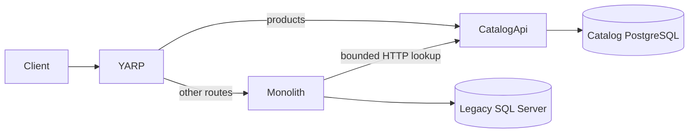

# Catalog extraction architecture

Before Phase 04, all routes and product reads/writes used the SQL Server monolith. After cutover, YARP routes only the Catalog API to Catalog Service. Its PostgreSQL Products table is the authoritative writer. LegacyCommerce still owns customers, inventory, orders, simulated payments, and notifications in SQL Server. The running Catalog Service has no SQL Server reference.

The anti-corruption port IProductCatalog returns only ProductSnapshot(Id, Price), not a shared EF entity. The Infrastructure HTTP adapter calls GET /api/products/{id} with a three-second timeout, cancellation, and correlation ID. A 404 means product absent; transport, timeout, malformed response, and non-success status become CatalogUnavailableException and a 503 on order/inventory endpoints. There is no stale SQL fallback. Historical orders retain ProductId and UnitPrice snapshots.

The Catalog schema is service-owned and has a primary key on Id plus a nonunique Name index. Name remains nonunique because source data has duplicates. Product categories and updates were absent from the existing domain and were not invented. The one-shot migration tool is the only project that references both database implementations. It is excluded from runtime service dependencies.

The Catalog API serves GET /api/products, POST /api/products, GET /api/products/{id}, /health (database), and /health/live (process). Public POST/list status and JSON contracts are preserved; the detail endpoint is an additive lookup. A service outage affects new orders and inventory changes but does not affect already-created order payment.
