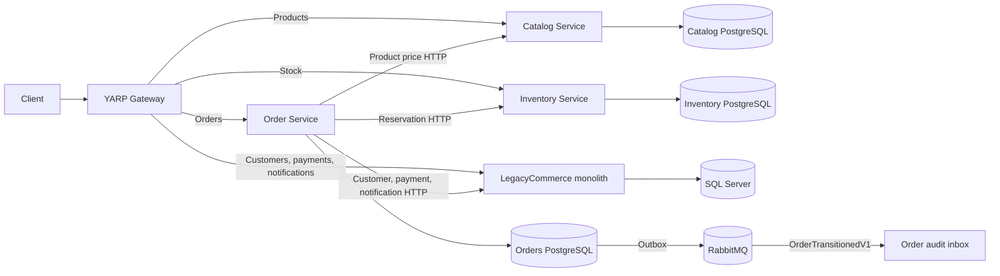

# Current architecture: Phase 06 development cutover

Development Orders ownership switched after 64 historical SQL orders were copied and verified in PostgreSQL. The monolith rejects direct order create/read calls in extracted mode; its public payment route forwards payment intents to Orders. Catalog and Inventory remain extracted. RabbitMQ and Docker were unavailable during local validation, so the RabbitMQ arrows show configured paths; the successful through-gateway workflow used in-memory MassTransit. See [Order extraction](orders-extraction.md) and [cutover procedure](../migration/orders-cutover.md).
