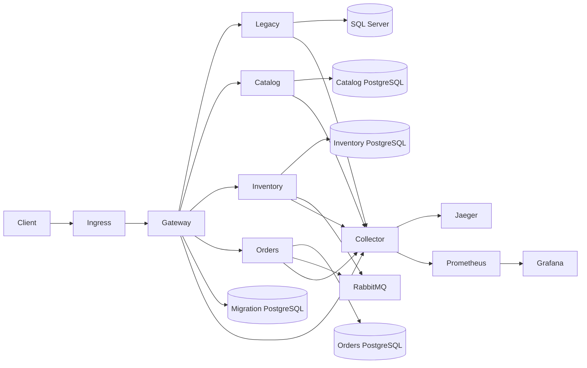

# Phase 09 deployment architecture

The five HTTP hosts use one multi-stage .NET 10 Dockerfile and distinct project/assembly build arguments. Only the gateway is externally routed. Catalog owns its PostgreSQL database, Inventory and Orders own separate PostgreSQL databases, the legacy host owns SQL Server, and the gateway stores migration coordination in a dedicated PostgreSQL database. RabbitMQ carries integration events. The Collector receives OTLP, Prometheus scrapes metrics, Jaeger stores traces, and Grafana displays dashboards.

Kustomize under [deploy/kubernetes](../../deploy/kubernetes/base/kustomization.yaml) deploys only stateless application hosts. The default production design uses externally managed SQL Server, PostgreSQL, RabbitMQ, and observability storage. The Compose environment is a single-host development demonstration with named persistent volumes; it provides no stateful high availability.

The gateway runs at least two replicas. Each routed request acquires the Phase 08 PostgreSQL authority lease. Administrative transitions use exclusive row locks and expected versions. Every replica must receive the same reviewed migration configuration; activation requires a revision check. If authority is unavailable, migration-sensitive routing fails closed and readiness fails. No replica may resume legacy writes for modern-owned data without the established reconciliation and rollback evidence.

The Kubernetes manifests are reference templates. Before deployment, replace image references with immutable digests, provision Secrets, set the ingress host and TLS, install a compatible ingress controller and metrics server, size resources, and validate provider-specific networking. Production outbound NetworkPolicies require environment-specific database, broker, DNS, and OTLP destinations.