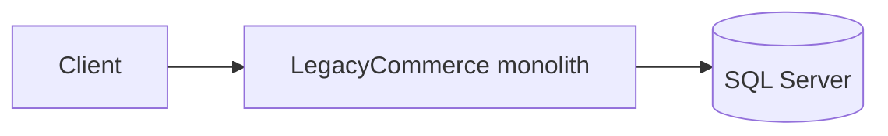
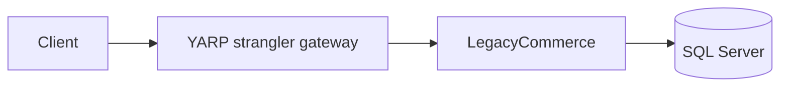
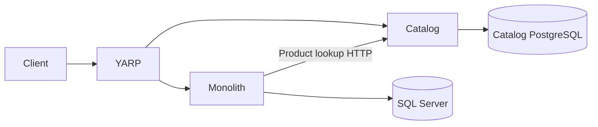
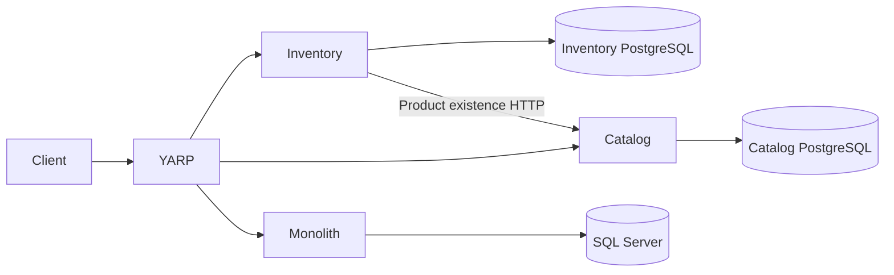
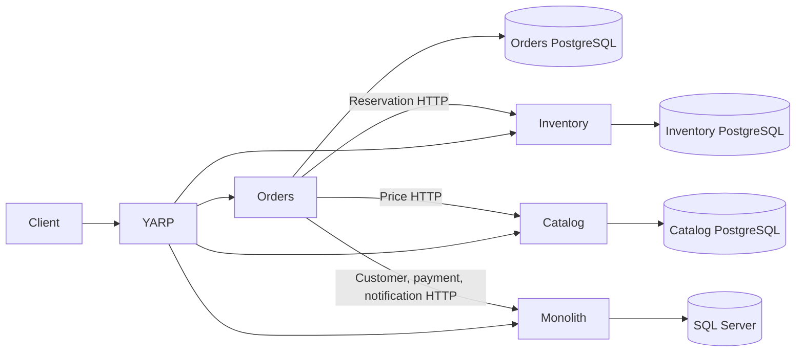
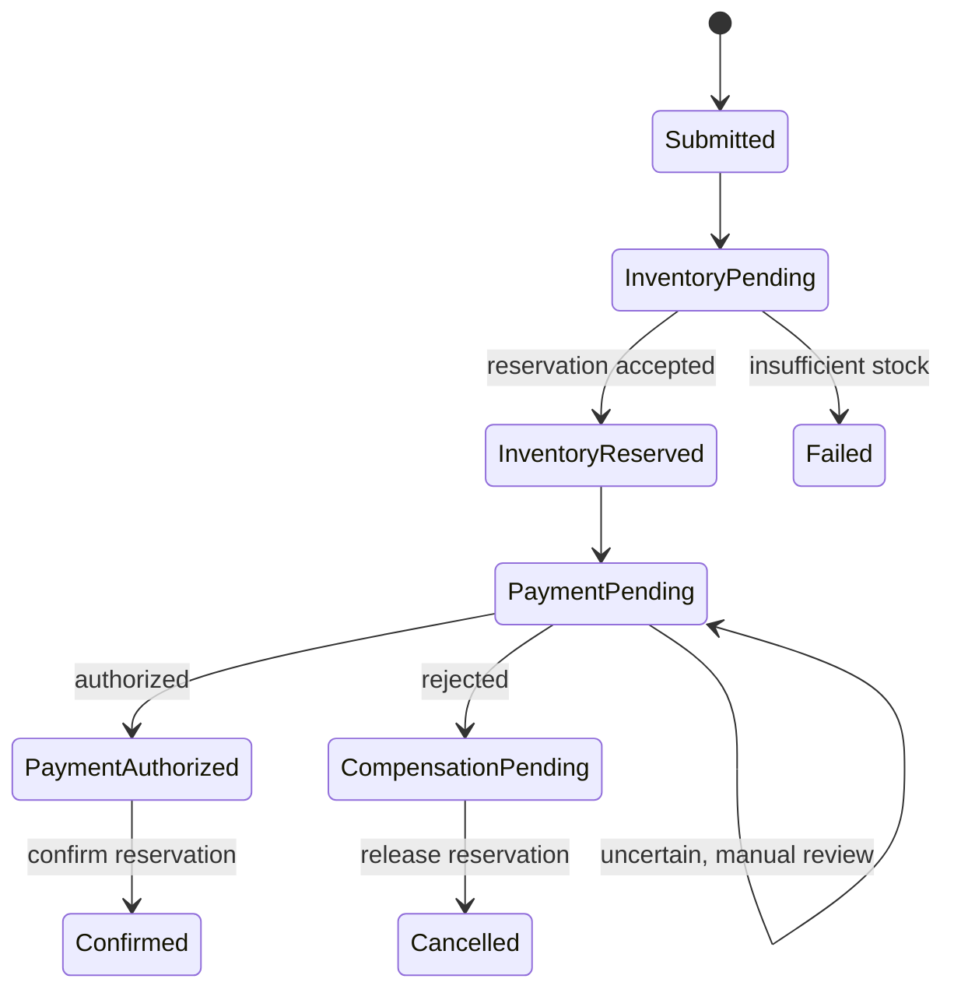
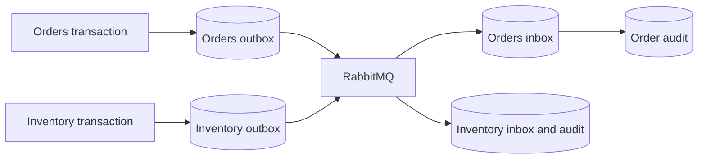
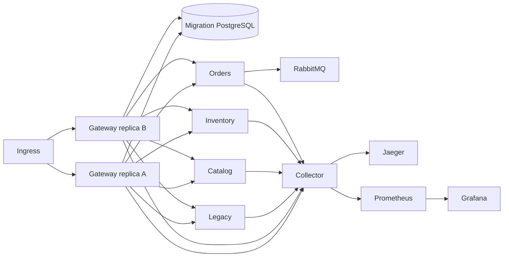
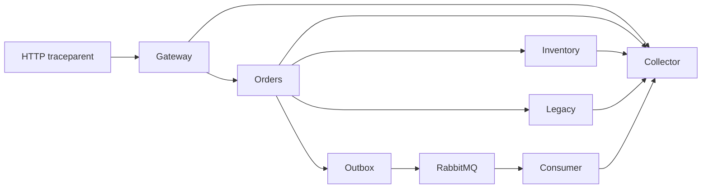
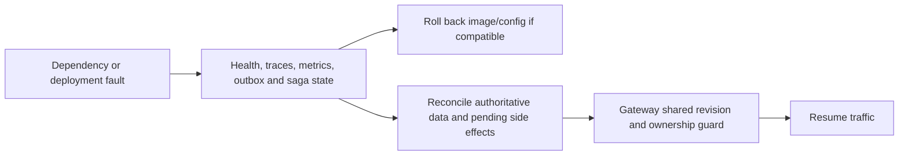

# Final engineering review

## Executive technical summary

StranglerForge demonstrates a controlled migration of LegacyCommerce from a six-module SQL Server monolith. Catalog, Inventory, and Orders have independently deployed APIs and PostgreSQL databases. Customers, simulated Payments, and Notifications remain in the monolith. A YARP gateway preserves the public route family and guards ownership transitions. The reference is suitable for studying migration mechanics; it is not qualified as a production deployment.

## Initial constraints and strategy

The original application had one deployable host, one SQL Server database, and synchronous module calls. A wholesale replacement would have put product identity, stock, orders, payment, and notification semantics at risk together. The project instead placed YARP in front, extracted bounded contexts in sequence, copied historical IDs under write freezes, verified data, and changed one authoritative writer at a time. Existing SQL tables remain for history and rollback analysis. No data was deleted in Phase 10.

## Architecture evolution

The final topology retains those business boundaries and adds PostgreSQL-backed gateway coordination, RabbitMQ integration events, OTLP telemetry, and container/Kubernetes deployment references.

## Data ownership and service communication

| Context | Authoritative writer | Remaining dependency |
| --- | --- | --- |
| Customers | LegacyCommerce / SQL Server | Orders queries customer existence by HTTP |
| Catalog | Catalog / PostgreSQL | Orders and Inventory query Catalog by HTTP |
| Inventory | Inventory / PostgreSQL | Orders sends idempotent reservation commands by HTTP |
| Orders | Orders / PostgreSQL | Legacy payment route forwards intent to Orders |
| Simulated Payments | LegacyCommerce / SQL Server | Orders calls idempotent payment authorization by HTTP |
| Notifications | LegacyCommerce / SQL Server | Orders requests an order-keyed notification record by HTTP |
| Migration control | Gateway / separate PostgreSQL | Every gateway replica checks shared state and configuration revision |

No service implementation queries another service's database. Stable product and order identifiers survive extraction. The gateway contains routing and migration safety logic, not commerce rules. The bounded contexts are documented in [bounded contexts](bounded-contexts.md); [data ownership](data-ownership.md) records cutover details.

## Distributed consistency

Orders persists an order and saga state in one Orders transaction and publishes transition events through the EF outbox. The worker resumes pending states after restart. Inventory reservations are keyed by the order ID and are idempotent. Definitive payment rejection enters compensation and releases stock; an uncertain payment outcome stays pending for operator review. Notification recording is keyed by order ID. Inbox storage and event IDs suppress duplicate audit side effects. No distributed transaction spans databases.

A MassTransit state machine Saga was considered. The current persisted application-worker Saga fits the small, linear order workflow and already gives explicit state, retry, and compensation points. A state machine would add transport-specific orchestration and migrations without resolving any observed correctness defect. Reconsider it if the workflow branches, independent participants increase, or event-driven orchestration becomes a measured requirement.

## Resilience, deployment, and rollback

Safe HTTP reads use bounded retry and circuit policies; mutating requests are not automatically retried by transport middleware. The gateway limits concurrent requests and fails closed on invalid migration state. Its PostgreSQL authority uses shared row locks for routed requests and exclusive locks plus expected versions for transitions. An authority outage makes readiness fail and prevents migration-sensitive routing; no replica can use a stale local file as a fallback.

An image rollback does not transfer database ownership. Legacy Catalog, Inventory, and Orders code and SQL history remain because no complete dependency and rollback-window audit proves safe removal. In extracted mode their direct execution paths are disabled or forwarded; deleting them now would remove a documented recovery option. Customers, Payments, and Notifications remain active in the monolith. The [deployment runbook](../operations/phase09-deployment.md) and [safe rollback](../migration/safe-rollback.md) are the operative procedures.

## Security boundaries

Public requests enter YARP. Migration administration requires a configured token and loopback peer; it is not an ingress operation. Orders-to-monolith internal commands use a shared internal token. Phase 10 adds separate production-mode Inventory stock-admin and reservation tokens; local Development without configured tokens keeps the existing educational workflow. Kubernetes uses non-root pods, read-only root filesystems, external Secret references, and ingress limited to the gateway. Cluster egress policy, mTLS, managed identity, customer-facing authorization, secret rotation, and image signing remain open deployment work.

## Validation evidence and limits

Phase 10 CI run #31 passed all 77 solution tests, including Inventory write authorization, plus two live PostgreSQL coordination tests and two live RabbitMQ tests. CI also passed the Testcontainers PostgreSQL/RabbitMQ check, five image builds, Compose interpolation, Kustomize rendering, and dependency audit. These tests do not establish live Kubernetes ingress, autoscaling, backup restore, or production threat resistance. No benchmark or kind cluster result is claimed.

## Final assessment

The project is a technically credible modernization reference with explicit data ownership, guarded cutover, durable order state, idempotent participants, failure-aware HTTP boundaries, and reproducible CI infrastructure. It is not production certified. The highest remaining work is environment qualification of the deployed topology, real identity and authorization, manual poison-message replay, and operational restore drills. See the [technical debt register](technical-debt.md).