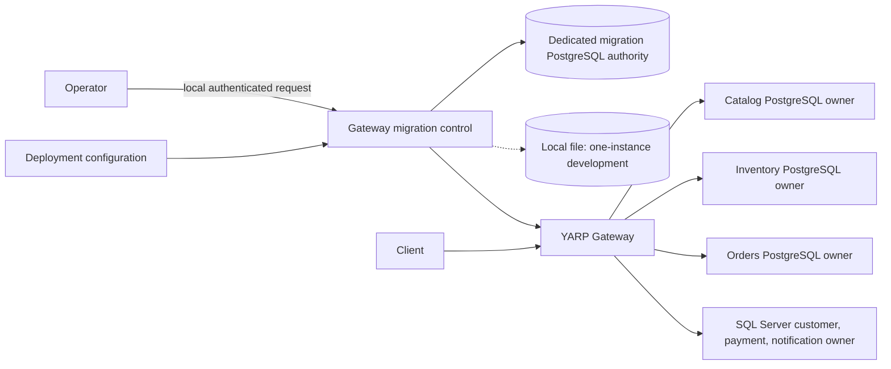

# Migration control boundary

Phase 07 adds validated per-service routing flags, a local lifecycle state file, audit records, and a loopback-plus-token administrative API. The control runs in the gateway because it governs traffic selection; it has no direct access to service databases. The current PostgreSQL owners remain Catalog, Inventory, and Orders. See [traffic migration](../migration/traffic-migration.md) for decisions and failure behavior, [canary routing](../migration/canary-routing.md), [shadow execution](../migration/shadow-execution.md), and [safe rollback](../migration/safe-rollback.md).

The file state is ignored by Git and restricted to the gateway content root for one-instance development. Replica deployments configure a dedicated PostgreSQL authority: API requests verify active flags under a shared row lock; transitions use an exclusive lock and expected versions. An unavailable or mismatched authority fails closed. The comparison history remains bounded in each gateway process; accepted transitions and configuration activations are persisted in PostgreSQL. The `StranglerForge.Migration` meter is exported through OpenTelemetry when an OTLP endpoint is configured.

Phase 08 adds an optional PostgreSQL authority for multi-instance deployments. It stores snapshots, accepted-transition audit, active flag fingerprints, and configuration activation audit; API requests hold a shared row lock while transitions use an exclusive lock. In this mode, unavailable or stale authority state fails closed with 503. The file implementation remains only for one-instance development. See [multi-instance coordination](multi-instance-coordination.md).
