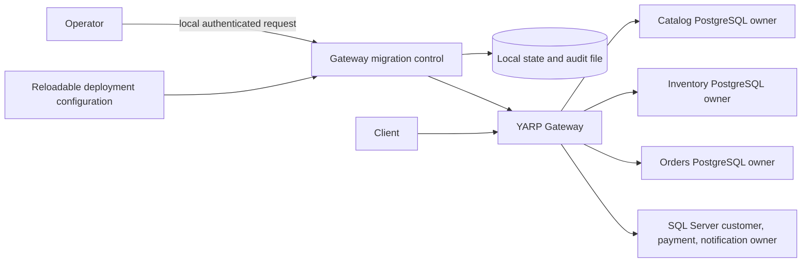

# Migration control boundary

Phase 07 adds validated per-service routing flags, a local lifecycle state file, audit records, and a loopback-plus-token administrative API. The control runs in the gateway because it governs traffic selection; it has no direct access to service databases. The current PostgreSQL owners remain Catalog, Inventory, and Orders. See [traffic migration](../migration/traffic-migration.md) for decisions and failure behavior, [canary routing](../migration/canary-routing.md), [shadow execution](../migration/shadow-execution.md), and [safe rollback](../migration/safe-rollback.md).

The state file is ignored by Git and restricted to the gateway content root. A single gateway instance is required for administrative transitions. Normal routing flags can reload; state transitions use optimistic version checks. Neither mechanism establishes database synchronization. The comparison history and counters are bounded in memory; accepted migration transitions are persisted. Phase 08 can attach telemetry exporters to the existing `StranglerForge.Migration` meter.
