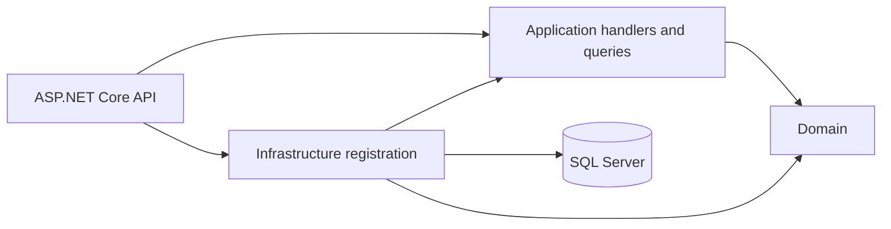

# Phase 02.1 application layer

The six HTTP endpoint modules bind requests, invoke application handlers or queries, and map use-case failures to the existing HTTP status codes. They contain no EF Core queries or transactions.

Command handlers: CreateCustomer, CreateProduct, AddStock, CreateOrder, ProcessPayment, and DispatchNotification. CommerceQueries provides read paths. The application depends on ICommerceStore and ICommerceTransaction ports. These interfaces expose operations needed by the use cases without a generic repository or mediator. The domain contains entities, order states, and creation/payment invariants. Infrastructure implements the ports with CommerceDb, EF Core, SQL Server, conditional updates, local transactions, and unchanged migrations.

Order creation checks the customer and product, conditionally reserves inventory, then saves the order in one SQL transaction. Payment conditionally claims a pending order, saves the payment and notification, and releases stock on failure in one transaction. A unique index on payment OrderId is a second duplicate guard. Existing API routes and response shapes are preserved.

Application and HTTP workflow tests cover success, insufficient inventory, failed payment, duplicate payment, stock release, and notification dispatch. Integration tests require local SQL Server.
