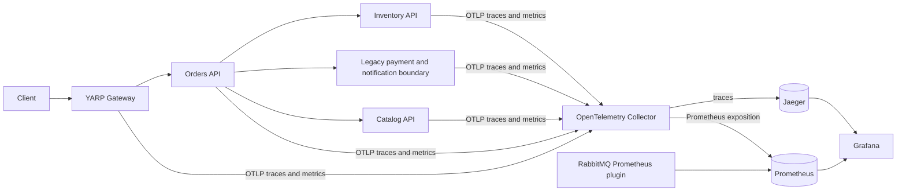

# Distributed observability

The shared `StranglerForge.Observability` library sets `service.name`, `service.version`, `service.instance.id`, and `deployment.environment`. HTTP server and client spans use OpenTelemetry instrumentation. `ActivitySource` adds order submission, saga advance, and inventory reservation spans. MassTransit and Npgsql activity sources are registered; actual broker trace continuity requires live RabbitMQ verification. W3C trace context is propagated by instrumented `HttpClient` calls. The existing `X-Correlation-ID` remains a separate business diagnostic identifier and is recorded in structured logging scopes, not as a metric label.

The Collector uses memory limiting, configurable probabilistic trace sampling, and batching. It exports traces to Jaeger and Prometheus-format metrics on an internal port. Prometheus is a metrics store, not a trace store. Collector, Prometheus, and Grafana configurations are under `deploy/observability`. Local Windows settings do not contain container hostnames; `OTEL_EXPORTER_OTLP_ENDPOINT` is supplied by Compose or the local environment.

Instrumentation avoids customer, order, reservation, and correlation identifiers as metric dimensions. Request bodies, credentials, payment values, and tokens are not added as span attributes. The .NET 10 built-in HTTP meters are registered once; ASP.NET Core and HTTP client instrumentation is used for traces.
