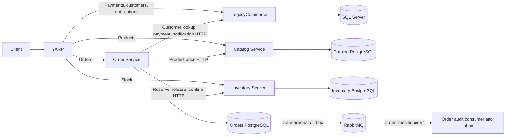
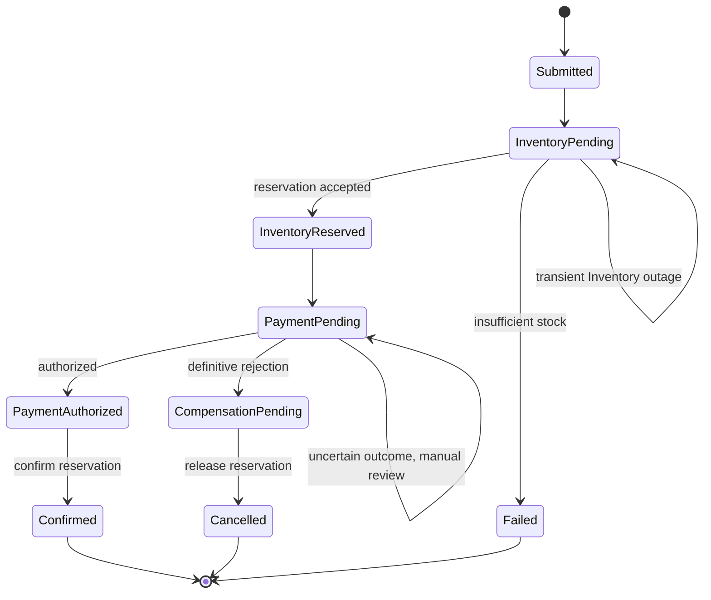
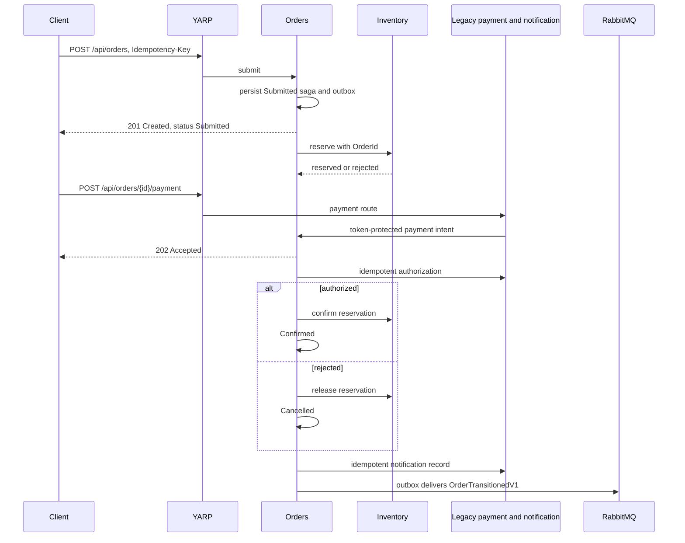

# Phase 06 Order extraction

The development gateway sends customer, payment, and notification routes to LegacyCommerce; product routes to Catalog; stock routes to Inventory; and order create/read routes to Orders. Orders owns its PostgreSQL `Orders`, `OrderItems`, `OrderSagas`, inbox, outbox, and transition-audit tables. Legacy SQL order rows are historical after the verified cutover. The monolith refuses direct order reads and writes in extracted mode. It still owns payment attempts and customer notifications behind token-protected internal commands. No service reads another service's database at runtime.

The saga is an application worker over persisted `OrderSaga` rows. It is not a MassTransit state-machine saga. A PostgreSQL compare-and-set transition updates order and saga state and publishes a versioned event through the EF bus outbox in one local transaction. Stable order IDs are used as Inventory reservation IDs and Payment operation IDs. Replayed HTTP calls are safe because Inventory transitions and the monolith's Payment/Notification boundaries are idempotent. A lost response can cause a repeated call, and the caller can reconcile using the same ID. Separate service databases never participate in a distributed transaction.

A definitive Inventory rejection ends in `Failed` without payment. A definitive payment rejection moves to `CompensationPending`; release can be retried with the stable reservation ID and ends in `Cancelled`. If payment authorization is uncertain, stock is **not** released. The saga remains in `PaymentPending` with a manual-review reason when the remote boundary returns an uncertain outcome. A network timeout is retried through the same idempotent payment operation. If a remote side effect succeeds just before the worker stops, restart repeats the same ID, then advances the persisted state. Operators must resolve any prolonged payment uncertainty before forcing compensation; the current service has no operator reconciliation API or timeout scheduler.

`X-Correlation-ID` is normalized by HTTP middleware, stored in saga state, forwarded to dependencies, included in `OrderTransitionedV1`, and recorded by the audit consumer. The outbox is durable when RabbitMQ is unavailable. `/health` checks Orders PostgreSQL for HTTP readiness, while `/health/messaging` also reports MassTransit broker readiness. Broker delivery is at least once; the consumer inbox and unique `EventId` audit key make the audit side effect idempotent. Live RabbitMQ, retry/error queues, and broker recovery remain unverified in the current environment.

The current public request contains one product. The Order aggregate persists that line as an OrderItem with its product ID, quantity, unit-price snapshot, and total. This keeps the existing API shape while giving Order items an explicit domain and persistence boundary.
