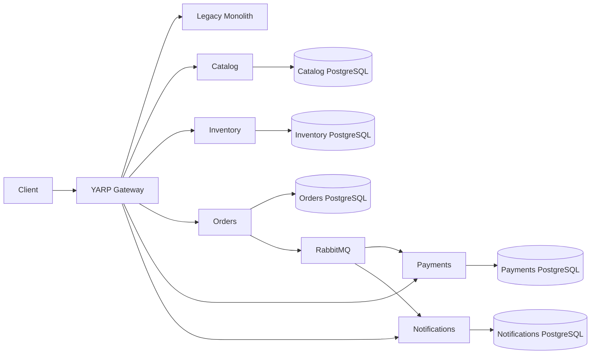

# Target architecture
This diagram is an aspirational fully extracted topology. Phase 10 ends with a hybrid architecture: Customers, Payments, and Notifications still run in LegacyCommerce. See [final engineering review](final-engineering-review.md) for the implemented topology.

