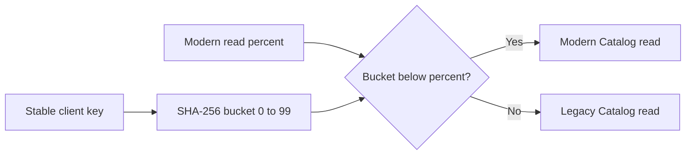

# Canary routing

The sole eligible route is `GET /api/products` before Catalog write ownership moves to PostgreSQL. Set `MigrationControl:Catalog:Owner=Legacy`, `LegacyReadAvailable=true`, and a validated `ModernReadPercent` of 0, 10, 25, 50, or 100. The lifecycle must be `CanaryReady`. The gateway hashes the UTF-8 `X-Migration-Key` with SHA-256, takes the first unsigned 32 bits modulo 100, and compares the bucket with the configured modern percentage. The same key and percentage choose the same destination. Without a key, the gateway chooses modern to avoid unstable per-request switching. The header is a routing affinity key, not authentication.

No percentage ever divides writes. Catalog POST uses only the authoritative writer and is rejected when ownership, migration stage, and YARP cluster disagree. In the current development deployment, Catalog is already modern, `ModernReadPercent=100`, and legacy reads are disabled because SQL is stale. Inventory and Orders cannot safely canary to legacy in this phase. Adjusting a flag alone cannot transfer ownership.
