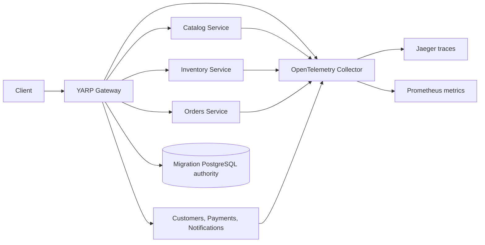

# Migration roadmap

1. Foundation.
2. Modular monolith and SQL Server.
3. YARP gateway.
4. Catalog extraction.
5. Inventory and messaging.
6. Orders and persisted saga.
7. Traffic migration and guarded rollback.
8. Resilience, observability, and multi-instance coordination.
9. Containers, Kubernetes, and broad deployment tests.
10. Final modernization review and engineering readiness.

Phases 01–07 are implemented; Phase 07 was merged to `main` as PR #1. Phase 08 was merged to `main` as PR #2. Phase 09 is implemented on `feature/phase-09-cloud-native-deployment` with CI validation passed; Kubernetes cluster runtime qualification remains open. The gateway can use a dedicated PostgreSQL migration authority for multi-instance state and configuration revisions. HTTP resilience, telemetry, dashboards, and development fault hooks are added without changing database ownership. All 77 solution tests and the isolated live PostgreSQL authority test passed. Docker is absent locally; Phase 09 CI verified image builds, Compose interpolation, Kustomize rendering, and isolated PostgreSQL/RabbitMQ Testcontainers. Full application deployment remains unverified. Phase 10 is implemented on `feature/phase-10-final-modernization` as a stacked branch on Phase 09; CI run #31 passed all 77 solution tests, two live RabbitMQ tests, two live PostgreSQL gateway coordination tests, container checks, image builds, manifests, and dependency audit. Kubernetes cluster rollout and performance benchmarks remain unverified.

