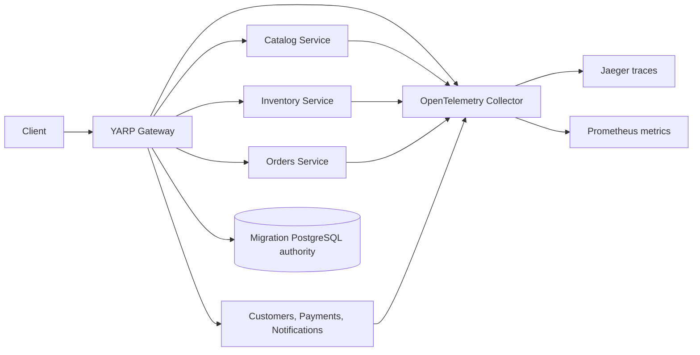

# Migration roadmap

1. Foundation.
2. Modular monolith and SQL Server.
3. YARP gateway.
4. Catalog extraction.
5. Inventory and messaging.
6. Orders and persisted saga.
7. Traffic migration and guarded rollback.
8. Resilience, observability, and multi-instance coordination.
9. Containers, Kubernetes, and broad deployment tests.
10. Final cutover.

Phases 01–07 are implemented; Phase 07 was merged to `main` as PR #1. Phase 08 is implemented on `feature/phase-08-resilience-observability` with local validation complete. The gateway can use a dedicated PostgreSQL migration authority for multi-instance state and configuration revisions. HTTP resilience, telemetry, dashboards, and development fault hooks are added without changing database ownership. All 77 solution tests and the isolated live PostgreSQL authority test passed. Docker and RabbitMQ runtime checks remain deferred because Docker is absent in this environment. Phase 09 has not started.

