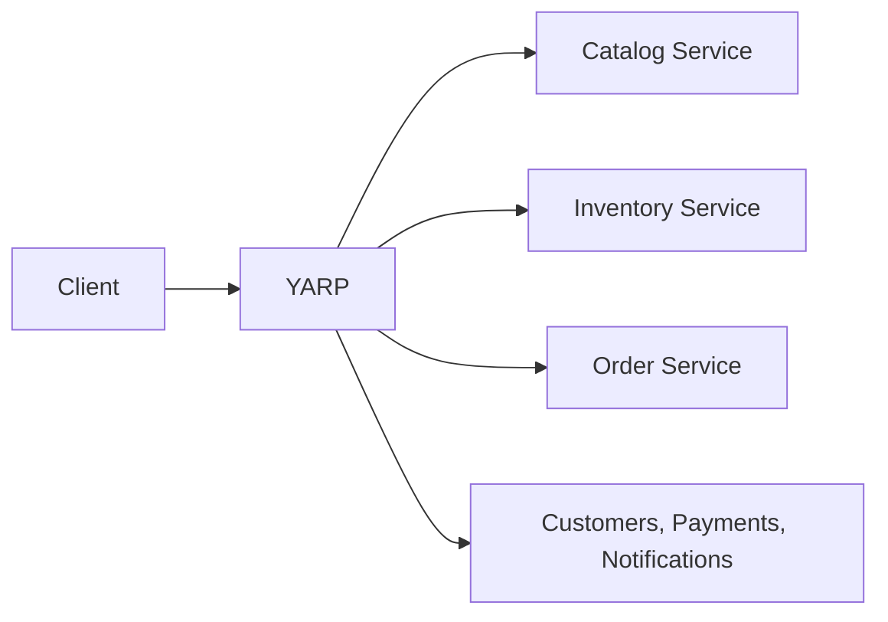

# Migration roadmap
1. Foundation.
2. Modular monolith and SQL Server.
3. YARP gateway.
4. Catalog extraction.
5. Inventory and messaging.
6. Orders and saga.
7. Traffic migration and rollback.
8. Resilience and observability.
9. Containers, Kubernetes, and broad tests.
10. Final cutover.

Phases 01, 02, 02.1, 03, and 04 are implemented and locally validated. Phase 05 development Catalog reconciliation, Inventory migration, and through-YARP cutover have passed. Phase 05.1 verified that Docker Desktop/Engine and RabbitMQ/Erlang are absent on Windows, and Docker/RabbitMQ are absent in Ubuntu WSL. Static Compose YAML and RabbitMQ wiring checks passed; live RabbitMQ delivery, outbox replay, inbox deduplication, retries, error queues, consumer restart, and Compose startup remain unvalidated. The existing 38 tests passed. Phase 06 development Order Service, 64-row historical import, coordinated development routing, and through-YARP workflow have passed. The 12 Orders tests use isolated PostgreSQL and in-memory MassTransit; all 51 solution tests passed after Phase 06. Live RabbitMQ, Docker Compose, and multi-replica saga behavior remain deferred; Phase 07 has not started.

