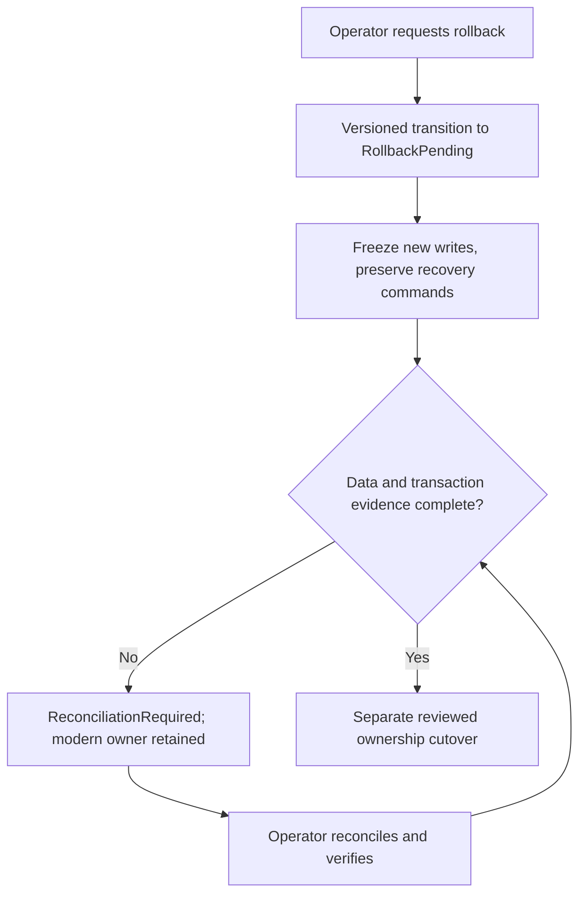

# Safe rollback and recovery

1. **Deployment rollback:** Revert gateway or service binaries while preserving the current PostgreSQL owner and API compatibility. Check the persisted Order saga worker and outbox still run.
2. **Routing rollback:** Only route reads to a destination with current compatible data. Do not route new Catalog, Inventory, or Orders writes to SQL after cutover.
3. **Feature flag rollback:** Restore the last validated flag set. Invalid or stale combinations return 503 rather than selecting a fallback writer.
4. **Data ownership rollback:** Freeze writes, establish a verified checkpoint, reconcile every post-cutover product, stock movement, reservation, order, payment, and notification, then separately verify schema compatibility and idempotency. This phase does not automate reconciliation.
5. **Transaction recovery:** Drain active sagas, inspect uncertain payments before compensation, settle or release pending reservations, and verify outbox/inbox progress. Do not replay ambiguous commands with a new operation ID.

The current development state is blocked: all three extracted stores have accepted writes, SQL is stale, and no complete reconciliation or live RabbitMQ recovery evidence exists. The migration API reports why. A modern outage must be repaired or the same idempotent operation resumed against the same owner; the gateway does not redirect a timed-out write to legacy. See [operational recovery](operational-recovery.md) and [Orders cutover](orders-cutover.md).
