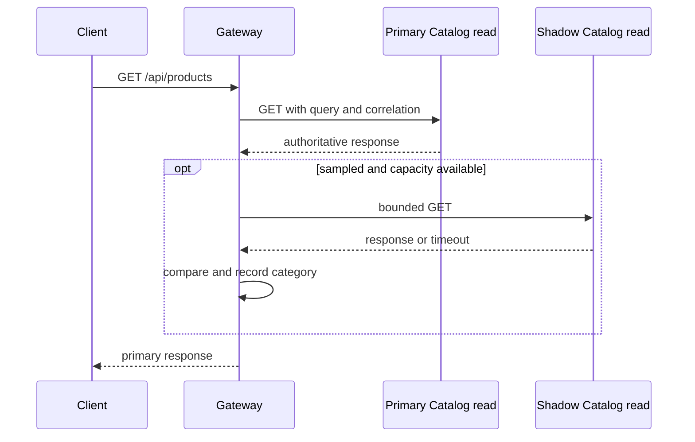

# Shadow read execution

Only `GET /api/products` may be shadowed during Catalog `ShadowValidation` or `CanaryReady`, when legacy reading is explicitly available before cutover. The primary response is buffered up to 256 KiB and remains authoritative. The secondary request sends only the path, query, an `Accept: application/json` header, and the correlation ID. It does not forward credentials, cookies, request bodies, or arbitrary client headers. The shadow has a 300 ms timeout and a gateway-wide concurrency limit of eight. Errors and timeouts become comparison diagnostics and never trigger a fallback or alter the primary status or body.

The gateway waits at most the shadow timeout before returning the buffered primary response; this adds bounded latency. Sampling uses the same stable key when supplied, otherwise the generated correlation ID. The current development configuration disables shadowing because the extracted-mode monolith returns 410 for Catalog list reads. No POST, PUT, PATCH, or DELETE shadowing is implemented.
