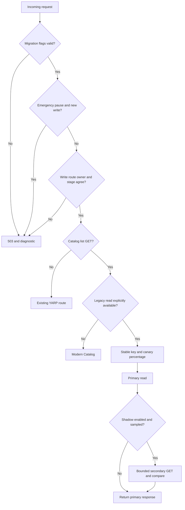
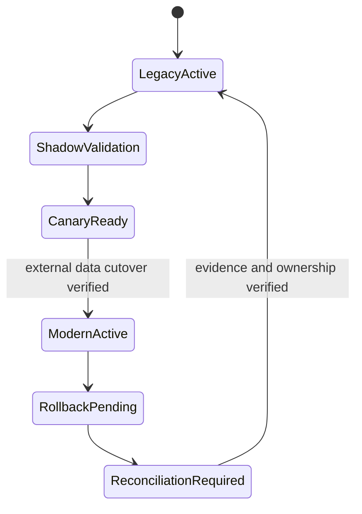
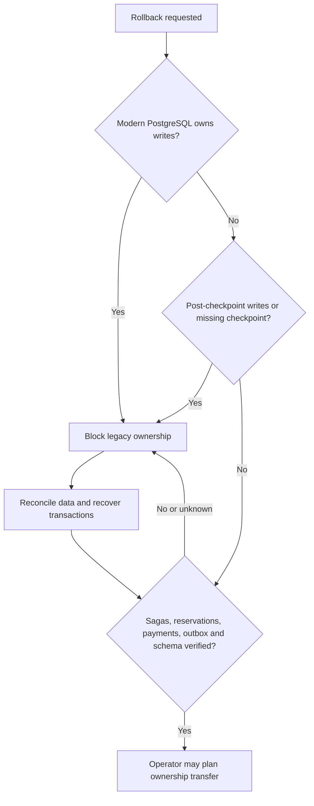

# Phase 07 traffic migration and control

## Architectural impact

Catalog PostgreSQL owns products and prices; Inventory PostgreSQL owns stock, reservations, and adjustments; Orders PostgreSQL owns orders and persisted saga progress. LegacyCommerce SQL Server still owns customers, simulated payment attempts, and notifications. The legacy Catalog list can read historical SQL rows only when its ownership mode is deliberately set to Legacy or ReadOnly. Its extracted-mode list returns 410, and it has no equivalent product-by-ID endpoint. The monolith does not expose the extracted Inventory reservation API; its Orders reads can show only historical rows after cutover. These facts rule out generic legacy fallback, write canaries, and current-development shadow comparisons. See [current architecture](../architecture/current-architecture.md) and [data ownership](../architecture/data-ownership.md).

The Phase 06 Order worker is a persisted application saga, not a MassTransit state-machine saga. SQL has no original order timestamps; imported timestamps reflect import time. Uncertain payments require operator review. RabbitMQ delivery, retry/error queues, and Docker startup were not validated locally. Phase 07 does not change these facts or the existing HTTP contracts.

## Routing decision

Only `GET /api/products` participates in read canary and shadow routing. `POST /api/products` remains on the configured authoritative writer and is rejected when its YARP cluster conflicts with the owner or migration stage. Inventory and Orders remain on modern routes in this deployment; their legacy endpoints do not support safe canary reads. Payment, notification, customer, and in-flight saga commands retain their existing boundaries. A modern outage returns an error; it never retries a possibly committed write against SQL Server.

## Lifecycle

Transitions use an expected version and are serialized in a gateway-local JSON state file. Accepted transitions write an audit record atomically with the new state. The file is local to one gateway instance; it is **not** a distributed coordination mechanism. Multi-replica deployments must use an operator-managed common control plane before changing migration state. `LegacyRetired` is defined but cannot be entered automatically while the legacy monolith still owns payments and notifications. A transition never changes database ownership or performs reconciliation.

## Administrative boundary

`/internal/migration` offers `GET /status`, `/flags`, `/ownership`, `/rollback/{service}`, `/comparisons`, `/audit`, and `POST /{service}/transitions` with `{ "target": "RollbackPending", "expectedVersion": 0 }`. All endpoints require a loopback client and `X-Migration-Admin-Token` equal to an operator-supplied `MigrationControl__AdminToken`. Without the token, the API returns 503; non-loopback callers receive 403. Do not expose this endpoint through YARP or a public load balancer. Keep the token in a secret manager or local environment, not source control. A rejected transition returns 409 and a diagnostic reason.

Flags are read and validated on each request, so supported configuration providers can update them without restart. Invalid changes fail closed with 503. The configured owner and YARP write cluster must agree. The state file records lifecycle and audit; flags remain deployment configuration. This local-only mechanism is deliberately unsuitable for a multi-replica production control plane.

## Rollback eligibility

The current development state is ineligible for legacy data ownership rollback: post-cutover writes exist in all three PostgreSQL stores and no verified reconciliation checkpoint is recorded. The API reports this explicitly. Operators must inspect active Order sagas, uncertain payments, Inventory reservations, outbox delivery, database synchronization gaps, and legacy schema compatibility before considering a future transfer. Deployment or gateway version rollback that keeps modern ownership is a separate operation. The gateway does not reconcile data or change owners automatically.
