# From Legacy Monolith to Cloud-Native Microservices: Engineering a Safe Migration with the Strangler Fig Pattern

*A practical architecture case study exploring .NET 10, YARP, DDD, distributed consistency, event-driven messaging, Saga orchestration, and progressive modernization.*

**By Erkin Emre Yılmaz**

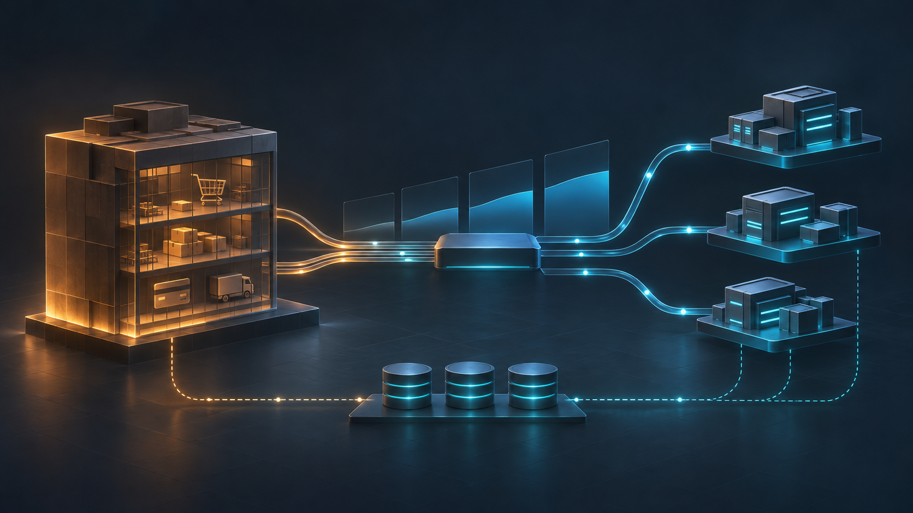

A legacy system can keep serving customers while its architecture changes. That requirement turns modernization into a problem of ownership and evidence: which component accepts a request, which database is authoritative, what happens after a partial failure, and how an operator knows a cutover is reversible. StranglerForge is an executable .NET 10 reference implementation built to examine those questions. It begins with a six-module commerce monolith and ends with a deliberately hybrid system: Catalog, Inventory, and Orders are extracted; Customers, simulated Payments, and Notifications remain in LegacyCommerce.

This is a reference project, not a production customer migration. Its CI and integration tests demonstrate specific behaviors. They do not establish production throughput, a deployed Kubernetes environment, or the security posture of a real merchant. That distinction matters throughout the design.

## 1. The modernization problem is continuity

Moving a monolith to newer libraries does not alter its deployment or data boundaries. LegacyCommerce initially put Customers, Catalog, Inventory, Orders, Payments, and Notifications in one ASP.NET Core host backed by SQL Server. The modules had distinct domain concepts, but they shared a process and database. A stock reservation, payment decision, order update, and notification could be orchestrated without a network call between separately deployed services.

Extraction changes the failure model. A reservation can commit while the caller times out. A payment may complete while its response is lost. A message can be published twice, or an application instance can die before publishing it at all. Meanwhile, public API clients still expect stable routes and responses. Existing product and order identifiers cannot casually change because they connect historical records and active workflows.

A whole-system rewrite would put these concerns into one cutover. It might be justified where the existing system cannot run safely or the domain is being replaced, but here it would obscure which behavior changed and why. StranglerForge instead treats modernization as a sequence of explicit ownership transitions. Each transition requires a compatible API, a data migration, a single writer, a validation checkpoint, and a recovery procedure.

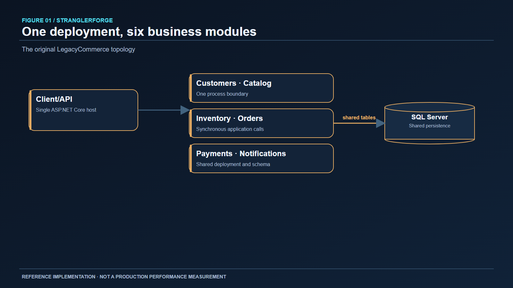
*Figure 1. The starting point: one deployable host and one shared SQL Server database. Module boundaries exist in code, but deployment and persistence are coupled.*

## 2. Why a strangler boundary?

The Strangler Fig pattern, described by Martin Fowler, permits old and new implementations to coexist behind an interception point. In this project the interception point is YARP, an ASP.NET Core reverse proxy. Clients keep calling the familiar `/api` route family while the gateway sends selected requests to an extracted service. The old application remains available for modules not yet moved and for explicitly supported recovery paths.

The useful unit of progress is an authoritative capability, not the number of processes. Before routing Catalog traffic to a new service, product data has to be imported, identifiers preserved, writes frozen or reconciled, and the new database established as owner. A proxy configuration change alone cannot do that. Similarly, a rollback decision must consider whether the old SQL rows are now stale. Routing reads back to SQL Server after PostgreSQL accepts writes would present an apparently healthy but incorrect system.

The pattern is particularly useful when public contracts must stay stable and bounded contexts can be moved independently. It is less attractive where the old system cannot be operated concurrently, where the domain is being abandoned, or where a small, coherent monolith already meets the relevant deployment and scaling requirements. Microservices are not a reward for reaching the end of a roadmap.

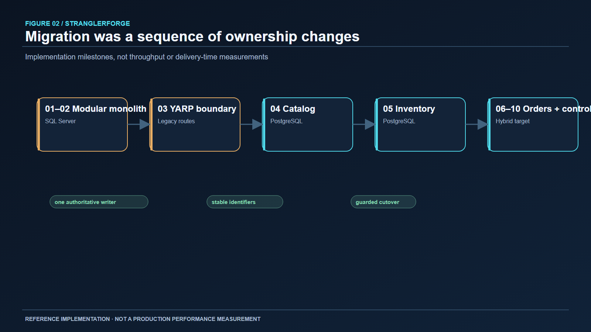
*Figure 2. Architecture milestones are ownership changes, not measured speed or performance gains. Customers, Payments, and Notifications remain in the monolith.*

## 3. Start with a working monolith

The reference did not begin by carving six empty service shells. LegacyCommerce was implemented as a modular monolith, with domain behavior and application use cases separated from HTTP binding and EF Core persistence. That made a meaningful baseline: customer registration, product lookup, stock management, order processing, simulated payment, and notification records worked before a distributed boundary was introduced.

This sequence exposes a practical DDD lesson. A bounded context is a model and ownership boundary, not merely a namespace. Catalog owns product identity and pricing. Inventory owns stock quantities and reservations. Orders owns order state. Payments decides authorization in this simulation. Notifications records the customer-facing result. In the first deployment, these concepts could coordinate inside one process. Once extracted, the same concepts need explicit HTTP contracts, stable identifiers, and rules for partial success.

Keeping the monolith operational is a migration constraint, not a sentimental preference. It lets the gateway route untouched capabilities to a known implementation while changes are isolated. The final architecture still depends on it for three active contexts. Removing it merely to claim a “complete” migration would require replacing those contexts and proving their operational behavior.

## 4. YARP as the traffic boundary

YARP is valuable here because it is a programmable ASP.NET Core reverse proxy with route and cluster configuration. StranglerForge uses it to preserve the public API surface while changing destinations. The gateway owns request routing, migration flags, shared authority checks, and protective policy. It does not calculate prices, decide payment outcomes, or reserve stock; those remain domain responsibilities.

A simplified configuration shape is:

```json
{
  "ReverseProxy": {
    "Routes": {
      "catalog": {
        "ClusterId": "catalog",
        "Match": { "Path": "/api/products/{**catch-all}" }
      }
    },
    "Clusters": {
      "catalog": {
        "Destinations": {
          "primary": { "Address": "http://catalog:8080/" }
        }
      }
    }
  }
}
```

The repository's actual route set is broader and its migration control guards which cluster is eligible. This example illustrates YARP's route-to-cluster relationship; it is not a drop-in copy of the deployed configuration. Correlation context must survive the proxy hop so a request can be followed through Orders, Inventory, and the monolith. Timeouts, readiness, and bounded concurrency matter because a proxy can otherwise amplify dependency failures.

A gateway also creates a governance risk: a route file could suggest that the legacy system is safe to serve while a modern service already owns writes. StranglerForge addresses this with ownership-aware migration state, shared PostgreSQL authority, revision checks, and route validation. Business correctness is enforced across the routing and data planes together.

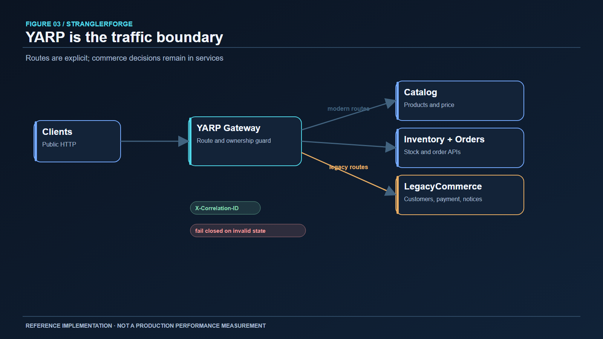
*Figure 3. The gateway is the public seam. It is not an alternate implementation of commerce rules.*

## 5. Catalog: the first service and the first data cutover

Catalog is a useful first extraction because product reads are relatively easy to separate, yet product IDs are referenced by stock and orders. The service owns its PostgreSQL database, API, and migrations. A SQL Server import tool copies product records while preserving identifiers. This is essential: regenerating product IDs would break references in the still-running monolith and subsequent Inventory migration.

The monolith no longer reaches directly into Catalog's tables. It uses an HTTP product lookup boundary, an anti-corruption layer that translates external product facts into the information its order workflow needs. Inventory similarly validates product existence through Catalog HTTP. This avoids treating a service-owned database as an integration API. It also introduces network dependency, which has to be visible in health, timeout, and error behavior.

The cutover is intentionally procedural. Import and verification happen under a write freeze; the new writer becomes authoritative only after IDs and data are checked. Historical SQL rows remain, but they are not an alternate live source. The repository documents a development recovery in which 21 stock-referenced product GUIDs missing from Catalog were appended without replacing 25 existing products; a repeat appended zero. That is development migration evidence, not a universal importer guarantee. The point is to reconcile references before switching ownership, not to hide discrepancies with fallback reads.

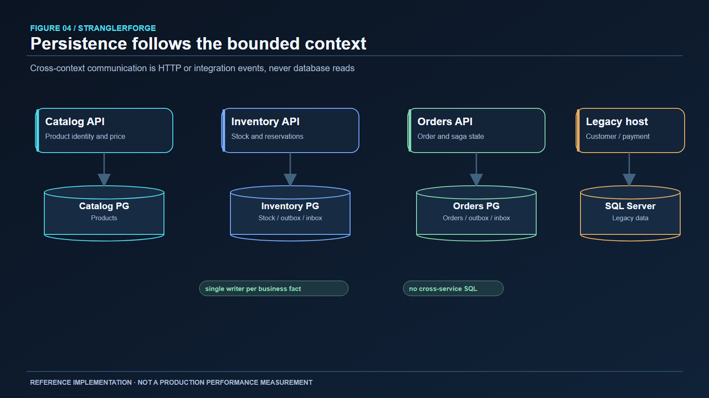
*Figure 4. One authoritative writer per context. Cross-context access uses contracts rather than another service's tables.*

## 6. Inventory: make reservation semantics explicit

Inventory extraction turns a local transaction into a distributed workflow. Its PostgreSQL database owns stock, reservations, adjustments, and audit state. Orders asks Inventory to reserve by a stable identifier tied to the order. A retried request can therefore find the same reservation rather than double-decrementing availability.

The critical invariant is that available stock cannot become negative through concurrent reservations. The implementation uses a conditional database update inside a transaction: it updates a stock row only when `Quantity - Reserved` is at least the requested amount. It then records the reservation and outbound event within the same transaction. A competing request that loses this race cannot rely on an earlier read; the conditional write is the authoritative check. Unique constraints and conflict handling cover duplicate reservation attempts and serialization or deadlock cases.

Reservation state also matters. A successful payment leads to confirmation. A definitive payment rejection leads to release. A timeout does not prove rejection: the payment could have succeeded while the response was lost. Automatically releasing stock on uncertainty could sell the same unit twice. StranglerForge instead keeps uncertain outcomes pending for investigation, with durable order state to resume or reconcile later.

The migration tool verifies stock totals and source stability before authoritative traffic moves. The README records a development cutover of 43 stock rows and zero pending reservations, followed by through-gateway workflow checks. Those figures describe one development database at that point in time. After Inventory starts accepting writes in PostgreSQL, the import must not be rerun against that target as if it were a fresh copy.

## 7. Reliable messaging means accepting duplicates

RabbitMQ and MassTransit are used for integration events, but the important design decision is the transactional outbox. Consider a stock transaction that commits, followed by a process crash before its `InventoryReservedV1` event reaches the broker. The stock change is durable; the event is missing. Reversing the order is no better: a published event could be consumed before the stock transaction rolls back. There is no atomic commit across PostgreSQL and RabbitMQ in this design.

The Inventory transaction therefore writes business state and an outbox record together. A dispatcher publishes the event later. If the broker is unavailable, the stock change and event remain committed for replay. Publication may occur more than once, so consumers use inbox records and stable event IDs to suppress repeated business side effects. This is at-least-once delivery with idempotent processing, not exactly-once distributed delivery.

The distinction between domain and integration events is useful. A domain event can describe a local business fact within a context; an integration event is a versioned contract for other contexts. It should carry enough identity and correlation data to support replay and diagnosis without exporting an internal aggregate wholesale. The repository's live RabbitMQ CI checks cover outbox replay, duplicate suppression, retry exhaustion, error-queue delivery, and processing after a fault is removed. Manual poison-message replay remains unverified.

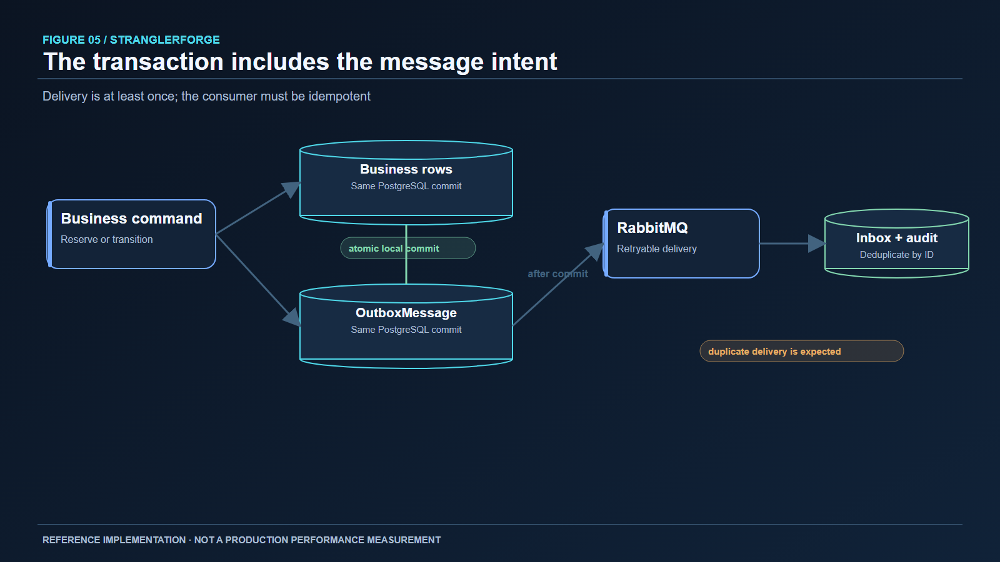
*Figure 5. The outbox closes the commit-to-publish gap; the inbox handles duplicate delivery. Neither turns a broker into a distributed transaction coordinator.*

## 8. Orders: a durable, small Saga

Orders is the third extracted context. Its PostgreSQL database owns order records and the progress of the order workflow. A persisted application worker, `OrderSagaRunner`, advances an order through submitted, inventory pending, inventory reserved, payment pending, and terminal or compensation states. The work is durable: after a process restart, the worker can resume pending transitions from database state rather than trusting an in-memory call stack.

The sequence is deliberately explicit. Orders validates customer existence through the monolith and product price through Catalog. It creates an order, asks Inventory to reserve stock, requests simulated payment authorization from the monolith, and confirms the reservation on authorization. On definitive rejection, it enters compensation, releases the reservation, and records a cancelled outcome. Terminal notification recording is keyed by order ID so a retried step does not send a second business effect. Internal participant endpoints use idempotency identifiers and dedicated authentication boundaries.

A realistic failure is a payment HTTP timeout. It is tempting to mark payment as failed and release stock. But a timeout is only evidence that the caller did not receive a response. The payment handler may have committed an authorization. The Saga keeps the order pending for review and reconciliation; it does not invent a compensating decision. Another failure is a release request that times out after a confirmed rejection. Compensation remains pending and can retry the idempotent release. The order should not be presented as cleanly cancelled until the release outcome is established.

This is not a MassTransit state-machine Saga. MassTransit handles messaging and outbox/inbox concerns; the workflow is a persisted application worker. For a small, mostly linear process, this makes state transitions and recovery points easy to inspect. A transport-oriented state machine may become attractive as independent participants and event branches multiply. It would not remove the need to classify ambiguous outcomes, preserve idempotency, or design compensation.

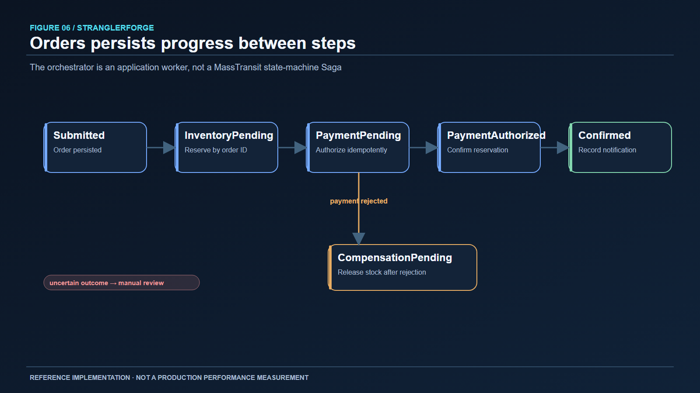
*Figure 6. Payment uncertainty remains pending. A definitive rejection takes the compensation path.*

## 9. Canary traffic and rollback are ownership problems

The gateway supports feature-controlled migration, deterministic canary selection, and shadow comparison. Canary routing can expose a modern read path to a controlled fraction of eligible requests. Shadow reads can compare a candidate response without making it authoritative. Neither mechanism permits splitting writes between two databases for the same business entity.

The route guard encodes that rule. Once a context's modern database is authoritative, the gateway requires modern routing for its writes and forbids stale legacy reads or shadows. Inventory and Orders extracted ownership is treated as a strong constraint. The gateway's shared PostgreSQL migration authority coordinates replicas: routed requests acquire shared locks, while state transitions acquire exclusive locks and check expected revisions and configuration fingerprints. If that authority is unavailable, migration-sensitive routing fails closed rather than letting replicas diverge on local configuration.

This adds operational cost. Every gateway instance depends on the authority store for safe routing, and a control-plane outage can reduce availability. The alternative—serving from a stale ownership view—risks silent data corruption. The project chooses correctness for ownership-sensitive operations. Canary selection is deterministic so a client is not randomly moved between implementations on each request, but a stable percentage is not proof of data equivalence. Contract comparison, reconciliation, and explicit promotion criteria still matter.

Rollback has layers. An application image can be rolled back if its database schema and contracts remain compatible. A gateway route can be rolled back only if the old implementation is still an authoritative, current source for that capability. A database ownership transition may require reconciliation or a controlled reverse migration; flipping the route is insufficient. The repository deliberately keeps old SQL history and disabled/forwarded legacy paths, while documenting that their presence does not make stale reads safe.

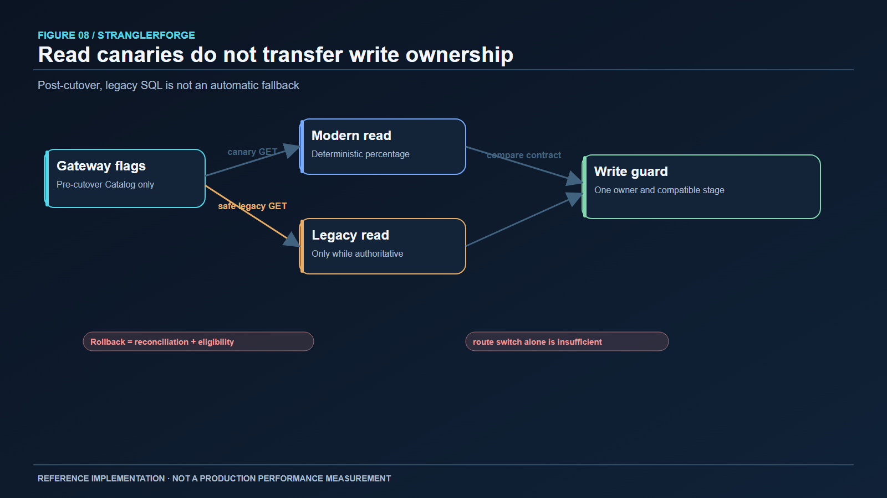
*Figure 7. The rollback gate depends on data ownership and freshness, not simply the ability to change a proxy route.*

## 10. Failure handling and observability

Distributed systems fail in combinations, so resilience policy must match operation semantics. Bounded retry is reasonable for safe reads after transient errors. Automatic retries of mutating HTTP calls can duplicate effects unless the endpoint has a stable idempotency key and well-defined replay behavior. Circuit breakers and timeouts protect callers from a dependency that is failing or slow; concurrency limits prevent the gateway from turning a downstream outage into resource exhaustion. Health checks distinguish a process that is running from one ready to serve its required dependencies.

The project instruments the gateway and services with OpenTelemetry. HTTP trace context crosses the gateway and synchronous service calls; integration events carry correlation information into asynchronous consumers. The deployment reference includes a Collector, Jaeger for traces, Prometheus for metrics, and Grafana dashboards. An order trace can explain where a request stopped, but operators also need durable state: pending Saga rows, outbox backlog, inbox records, and error queues. A trace alone does not prove a stock reservation was confirmed or released.

The acceptance matrix describes observability as partially verified. Trace propagation is tested and dashboard definitions are parsed, while a live Collector-to-backend flow has not been exercised. It would be misleading to infer alert quality, tracing completeness, or production incident response from configuration files. Likewise, no latency improvement or throughput result is claimed.

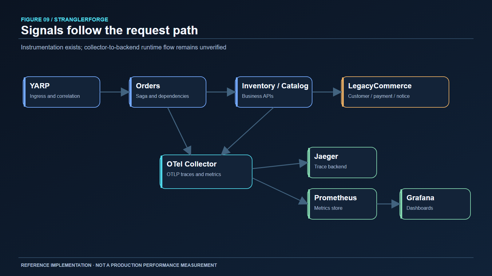
*Figure 8. Telemetry explains a workflow; persisted Saga, outbox, and inbox state remains the source for recovery decisions.*

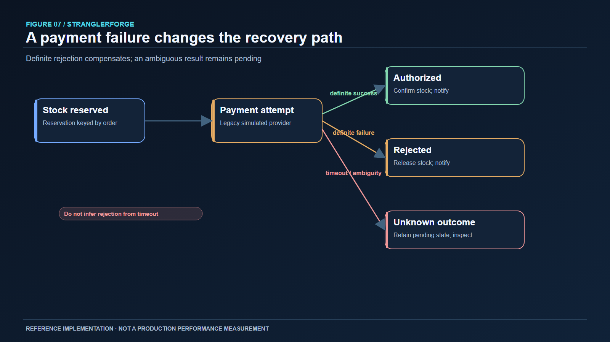
*Figure 9. Failure classification determines recovery. Ambiguous payment outcomes are not treated as definitive rejection.*

## 11. Deployment is more than a manifest

StranglerForge supplies multi-stage Dockerfiles for the five application images, a Compose topology, Kubernetes Kustomize overlays, probes, and GitHub Actions checks. The reference emphasizes non-root containers and external Secret references. In Kubernetes, application replicas are largely stateless, while SQL Server, PostgreSQL, and RabbitMQ remain stateful dependencies with separate operational requirements. Database migrations, secret rotation, backups, and restore procedures cannot be delegated to a rolling Deployment update.

The Phase 10 CI built five images, checked Compose interpolation, rendered the Kustomize overlays, and ran isolated infrastructure tests with disposable PostgreSQL and RabbitMQ containers. These are valuable configuration and packaging checks. They do not show that the entire application stack started in containers, that Kubernetes admitted the resources, that ingress routes worked in a cluster, or that a backup restore drill succeeded. The deployment runbook is therefore a starting point for environment qualification, not a production approval stamp.

The same precision applies to security. There are protected internal and administrative routes, dependency auditing, and container hardening checks. The final engineering review still identifies end-user identity, stronger service identity, egress policy, secret rotation, and image signing as deployment work. A reference that intentionally models a payment simulation must not imply payment compliance.

## 12. What the tests actually establish

The merged main branch's Phase 10 CI run #31 reported 77 solution tests, two live RabbitMQ tests, and two live PostgreSQL gateway coordination tests. The latter exercise two gateway hosts sharing migration authority, stale-write rejection, and recovery after authority restoration. The messaging checks exercised outbox replay and inbox duplicate behavior against a real broker, plus retry exhaustion and error-queue behavior. Orders integration tests cover restart, timeout, compensation, and durable transitions against isolated PostgreSQL. Gateway tests cover invalid routing, rollback rejection, canary and shadow behavior, and administrative protection.

These tests make several failure claims stronger than a diagram could. A stock update and outbox row remaining committed while the broker is down shows the transaction boundary. Re-delivery with one audit side effect shows idempotency. Two gateway hosts rejecting stale transitions show that migration coordination is not merely process-local. They still do not establish a full production failure envelope. The acceptance matrix marks API compatibility and data ownership as partial: no published OpenAPI diff gate or final production data inventory exists.

The repository also builds the solution, audits dependencies, builds images, and validates deployment configuration in CI. No executed performance benchmark, Kubernetes rollout, backup restore, full collector pipeline, or customer-facing authorization study is recorded. In a real adoption, those would be exit criteria with evidence attached to the intended environment.

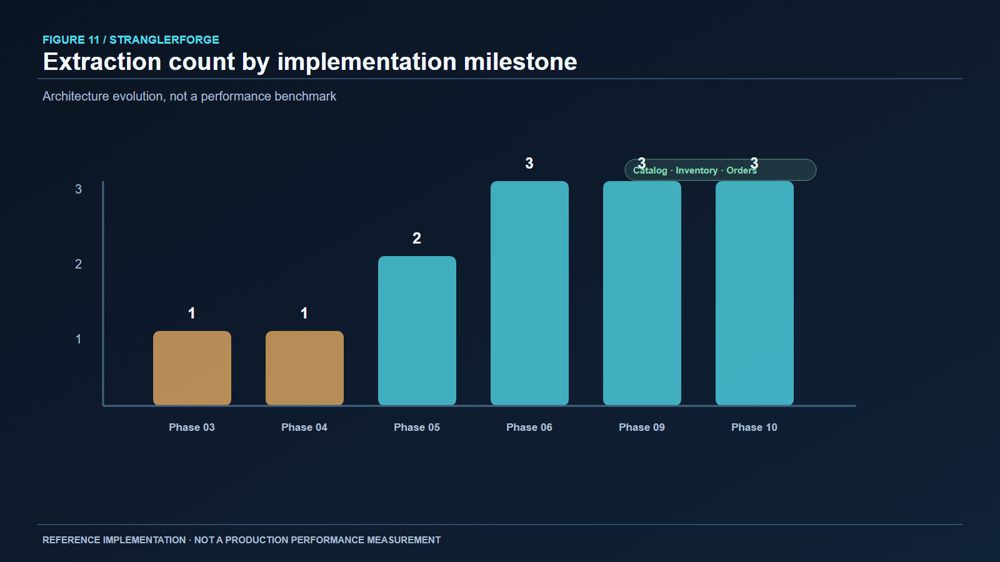
*Figure 10. Implementation milestones, not a benchmark: Catalog, Inventory, and Orders become independent context owners by the final architecture.*

## 13. Trade-offs worth keeping visible

The major benefit of incremental migration is a smaller blast radius per change. Its cost is a period of coexistence. Old and new code need compatible contracts; the gateway needs an ownership model; migration tools and reconciliation become part of the product. A team can easily underestimate this transitional complexity if it treats service extraction as moving a controller and changing a connection string.

Database-per-service clarifies ownership and prevents one service from bypassing another's invariants. It also replaces shared transactions with idempotent commands, durable workflows, and eventual consistency. Synchronous HTTP remains useful where an order must obtain customer, price, reservation, or payment decisions promptly. It couples availability and latency to those dependencies. Events decouple some consequences and improve replay, but they add broker operations, schema evolution, duplicate handling, and error-queue procedures. Neither style is inherently superior in every interaction.

The Saga is another trade-off. Explicit compensation makes the workflow inspectable, but compensation is not a time machine. Releasing inventory after a payment rejection is possible; undoing an uncertain payment without confirmation is unsafe. The architecture therefore needs states for uncertainty and human reconciliation. This is less tidy than a happy-path sequence chart and more honest about the business.

Finally, operational readiness is distinct from architecture completeness. The reference demonstrates safe ownership rules, durable messaging, and a reproducible CI path. A production deployment would still need real identity, threat modeling, secret management, backup and restore drills, scale testing, on-call procedures, and cluster validation. For a smaller system with no independent scaling or deployment need, the modular monolith might remain the better long-term design.

## 14. The final architecture is intentionally hybrid

The current public entry point is YARP. Catalog, Inventory, and Orders are independent APIs with separate PostgreSQL databases. Orders calls Catalog for price, Inventory for reservations, and LegacyCommerce for customer, simulated payment, and notification operations. Inventory calls Catalog for product existence. RabbitMQ carries integration events through outbox/inbox boundaries. A separate PostgreSQL authority coordinates gateway migration state. OpenTelemetry provides a trace and metric path to the configured observability stack.

LegacyCommerce and SQL Server remain active for Customers, Payments, and Notifications. Historical legacy Catalog, Inventory, and Orders data and code are not automatically safe to revive as writers. That distinction is central to the final diagram: a surviving monolith does not imply shared authority. The completed reference demonstrates a progressive migration with clearly stated remaining boundaries, rather than counting removed lines of monolith code as the success metric.

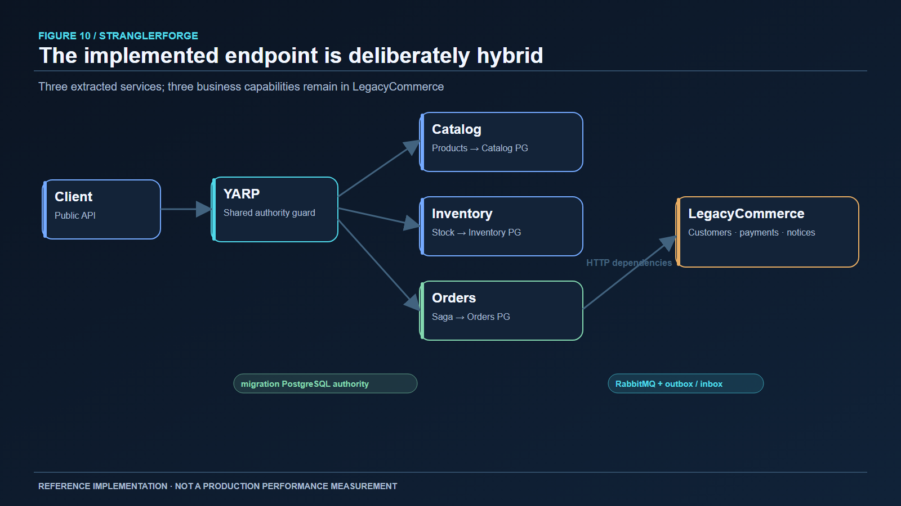
*Figure 11. The implemented hybrid system. The monolith remains an active participant; modern services own Catalog, Inventory, and Orders.*

## 15. Conclusion

The practical core of a Strangler Fig migration is not the proxy. It is the disciplined transfer of authority while users and workflows continue to operate. StranglerForge makes that transfer inspectable: preserve identifiers, establish one writer, use service contracts across data boundaries, record work before publishing events, make retries idempotent, persist long-running order state, and refuse rollback routes that would serve stale data.

The project is an executable reference, with tested behaviors and documented limits. Its most useful lesson is that safe modernization requires evidence at each boundary. The [StranglerForge repository](https://github.com/erkinemre/StranglerForge) contains the source, ADRs, migration runbooks, tests, and deployment references for readers who want to examine the decisions in detail.

---

**Further reading:** [Fowler's original Strangler Fig discussion](https://martinfowler.com/bliki/StranglerFigApplication.html); [YARP configuration](https://learn.microsoft.com/en-us/aspnet/core/fundamentals/servers/yarp/config-files); [RabbitMQ reliability](https://www.rabbitmq.com/docs/reliability); [PostgreSQL explicit locking](https://www.postgresql.org/docs/current/explicit-locking.html); [OpenTelemetry signals](https://opentelemetry.io/docs/concepts/signals/); [Kubernetes rolling updates](https://kubernetes.io/docs/tasks/run-application/update-deployment-rolling/).
